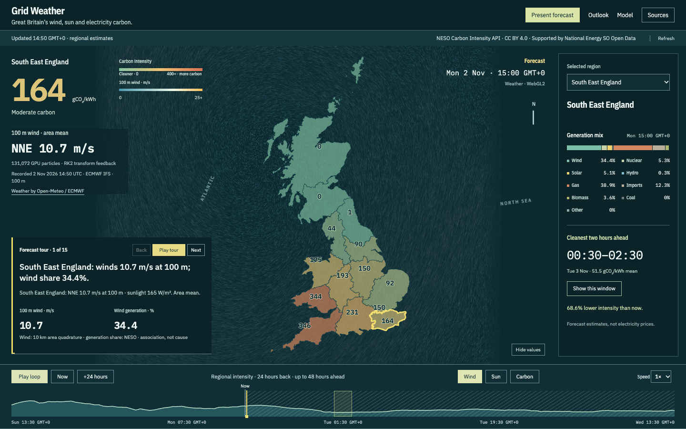

# Grid Weather

[](https://harryfreeman.dev)

Great Britain's electricity carbon forecast, presented as a weather broadcast. A real wind field moves across the map; a small, inspectable forecaster trains in your browser and shows how it fares against NESO. The point is to make a changing grid legible—and to put the evidence, dates and limitations beside the picture.



## Try it

Use Node.js 24 or later:

```sh
npm ci --ignore-scripts
npm run dev
```

Open **http://127.0.0.1:4173** for the local preview. The server binds to loopback. Alternatively, `npm run build` creates `dist/` and `npm start` serves it on the same local address.

No account, API key, local model or pretrained weights are needed. Package installation needs the network; building does not. The app tries the public Carbon Intensity API and retains a labelled saved forecast when offline. Weather refresh is manual and uses Open-Meteo. The bundled inputs were captured in November 2026 and have finite coverage: they are a dated demonstration, not today's forecast. When offline, the timeline refers to the saved carbon capture. For current carbon data, refresh weather as well; the model evaluation remains tied to its bundled dataset.

Choose **Wind / Sun / Carbon**, scrub time, or **Present forecast**. The tour advances to data-derived changes, highlights the named regions and prints supporting values. **Model** opens forward predictions, held-out scores and a hypothetical wind control. Reduced motion and the SVG fallback retain static source-derived fields and all forecast controls.

To check the code:

```sh
npm run check
npm run browsers:install
npm run dev # leave running in a separate terminal
npm run test:browser
npm run test:fonts
```

Browser checks run Chromium, WebKit and Firefox sequentially, silently, against intercepted public-data fixtures. They require an available browser slot and at least 10 GiB free disk space. Matching installed browser builds are reused; otherwise the installer downloads them into `.cache/browsers/`. See [validation](docs/validation.md) for the hardware-dependent checks and CI boundary.

## How it works

The carbon view uses the [NESO Carbon Intensity API](https://carbon-intensity.github.io/api-definitions/), including 14 distribution regions. Captions are rules over the forecast: largest changes, cleaner-band crossings, cleanest two-hour windows and fuel-share changes. They describe measured shares, never an inferred cause.

[Open-Meteo's ECMWF IFS 0.25° fields](https://open-meteo.com/en/docs/ecmwf-api) supply 100 m wind, cloud, shortwave radiation and temperature. A projected 18 × 16 lattice covers Britain and adjacent seas. WebGL2 transform feedback advances 131,072 desktop tracers or 32,768 phone tracers with an explicit midpoint integrator; bilinear spatial and linear temporal interpolation supply velocities. Trails show virtual motion through the selected field at 1,200× real time. The implementation uses the [WebGL 2 specification](https://registry.khronos.org/webgl/specs/latest/2.0/), without a rendering library.

A worker fits 15 standardized ridge regressions—one per region and one for GB—with chronological tuning and an unpenalized intercept. The method follows [Hoerl and Kennard (1970)](https://doi.org/10.1080/00401706.1970.10488634). Ten weather, daily-cycle and lag features predict intensity; the next 48 hours use recursive lag predictions. The frozen NESO comparator, later targets and model contributions remain visible. [Architecture and evaluation details](docs/architecture.md) explain the sampling, solver, cutoffs and recorded fallback.

## What it measures / proves

- **Forecast comparison:** bundled GB mean absolute error is **49.4 gCO₂/kWh** for ridge, **31.8** for NESO and **42.6** for daily persistence over **21 paired hours**. Targets are the national actual series; the NESO forecast was captured on 1 November 2026. Both baselines beat this model.
- **Numerical integration:** a browser GPU readback reproduces known midpoint and constant-field reference positions to within **10⁻⁶**, with no GL errors where transform feedback is available.
- **Interface contracts:** the serial three-engine suite checks desktop and phone forecast receipts, map/time synchronization, keyboard controls, model reproduction, reduced motion and failure states. It records meaningful paint and frame intervals separately from GPU-worker and training times.
- **Typeface stability:** delayed-font Chromium checks measured **0 font-swap CLS** at 1440 × 900 and 390 × 844. This does not mean whole-page startup CLS is zero. Other engines use geometry checks where the native layout-shift API is unavailable.

The [validation record](docs/validation.md) distinguishes measured results, reproducible checks and checks excluded from CI.

## Limits

This is an explanatory experiment, not an operational grid forecast or a connection lookup. Regional carbon targets are historical estimates, so their backtest scores measure revisions rather than independently observed emissions. The short GB comparison uses seasonal-persistence weather because an as-issued weather archive was unavailable; historical training-data vintages were not preserved. It is a retrospective comparison, not an operationally vintaged benchmark.

Regional weather averages weight land area, not turbine capacity, and omit offshore farms outside the regions. Weather correlations and model contributions are associations. Wind tracers are neither observed air-parcel tracks nor power flows. The projection is an approximation, boundaries are simplified, and the supplied data expire. Hardware acceleration and timing vary by browser and machine. Open-Meteo's free endpoint has [non-commercial fair-use terms](https://open-meteo.com/en/terms).

## How it was built

Designed, specified and reviewed by Harry Freeman; built with AI coding agents.

- Harry's initial brief set a clean-room public-data forecast, dated offline states, accessible controls and an honest account of what the display can show.
- His second brief chose the TV weather and Met Office chart medium: a full-bleed map, hatched forecast timeline and a forecast presented through visible evidence.
- His third brief added the physical weather behind the grid: real wind on the GPU and a browser-trained forecaster scored against NESO.
- Review required temporal captions, synchronized map highlights and time, and whole-gram outlooks with a shared scale. Harry later chose the shared IBM Plex type family.

## Licence

Code: [MIT](LICENSE), Copyright (c) 2026 Harry Freeman. The HF badge has a separate [mark notice](docs/brand/LICENSE.md). IBM Plex fonts: SIL Open Font License 1.1, with original notices in `public/fonts/`. Carbon Intensity and Open-Meteo data: CC BY 4.0; weather attribution includes ECMWF. DNO boundaries: NESO Open Data Licence. **Supported by National Energy SO Open Data.** See [dependency licences](DEPENDENCIES.md) and [data sources](data/SOURCES.md).
